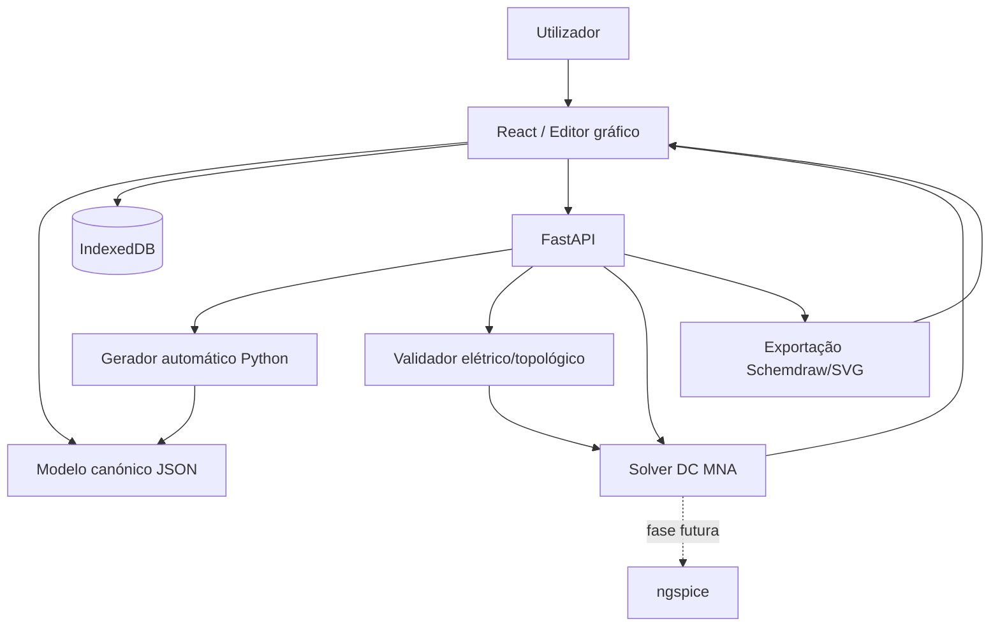

# Arquitetura e plano de desenvolvimento — Simulador Web de Circuitos

**Versão:** 1.0  
**Data:** 11-10-2026  
**Estado:** Proposta técnica / MVP  
**Idioma:** Português (Portugal)

## 1. Objetivo

Criar uma aplicação web para **desenhar, gerar, editar, validar e simular circuitos elétricos e eletrónicos** com dois modos interoperáveis:

1. **Manual:** colocar componentes predefinidos num editor gráfico, mover/rodar símbolos, ligar terminais e editar propriedades.
2. **Automático:** selecionar uma topologia/modelo e parâmetros, ou fornecer uma descrição estruturada; o backend Python gera componentes e ligações, devolvendo um circuito **editável** no mesmo editor.

Ambos os modos devem produzir **o mesmo modelo canónico de circuito em JSON**. O utilizador pode alternar entre os modos sem perder componentes nem ligações. A simulação é uma função separada do desenho.

### 1.1 Objetivos do MVP

- Editor com grelha, zoom, pan, seleção, movimento, rotação e ligações entre terminais.
- Catálogo inicial: fonte DC, resistência, interruptor, lâmpada resistiva, terra e instrumentos virtuais.
- Gerador automático de circuitos DC simples: série, paralelo e mistos básicos.
- Validação topológica e análise DC estacionária, com resultados de tensão, corrente e potência.
- Guardar/abrir projetos JSON; exportar SVG/PNG.
- Testes automatizados e exemplos reproduzíveis.

### 1.2 Fora do MVP

- Simulação transitória AC, semicondutores avançados, microcontroladores e firmware.
- Simulação certificada de instalações 230/400 V, disparo real de disjuntores/diferenciais e segurança normativa.
- Colaboração em tempo real, contas e marketplace de componentes.
- Execução arbitrária de código Python submetido por utilizadores.

> **Segurança:** resultados de simulação são educativos e aproximados; não substituem projeto, inspeção ou ensaios de instalações reais por profissionais qualificados.

## 2. Stack recomendada

| Camada | Tecnologia | Finalidade | Notas |
|---|---|---|---|
| Frontend | React + TypeScript + Vite | Aplicação SPA | Adequado a GitHub Pages |
| Editor gráfico | React Flow (`@xyflow/react`) + SVG personalizados | Nós, terminais, ligações e interação | Para esquemas elétricos, implementar fios ortogonais e junções explicitamente |
| Estado | Zustand | Estado do editor, seleção, histórico | Separar estado visual do circuito elétrico |
| Formulários | React Hook Form + Zod | Propriedades e validação de entradas | Tipos TS partilhados por esquema JSON |
| Backend | Python 3.12+ + FastAPI + Pydantic | API, geração, validação e simulação | Python executado no servidor |
| Geração de esquemas | Schemdraw | Exportação SVG e diagramas programáticos | **Não** é o editor visual interativo |
| Simulação MVP | Solver Python próprio (MNA DC) | Resistores, fontes DC, correntes e nós | Testável; suportar singularidades e casos inválidos |
| Simulação futura | ngspice (via processo isolado ou integração apropriada) | Análise AC/transitória e modelos SPICE | PySpice é opcional; confirmar compatibilidade e manutenção |
| Gráficos | Recharts | Curvas e resultados | Fase posterior para transitórios |
| Persistência local | IndexedDB (ex.: Dexie) | Projetos offline | JSON exportável/importável |
| Testes frontend | Vitest + Testing Library + Playwright | Unitários, componentes e E2E | Testar interações de ligação |
| Testes backend | pytest + httpx | Solver e API | Fixtures com circuitos conhecidos |
| CI/CD | GitHub Actions | Lint, testes, builds, deploy | Frontend e backend com pipelines separados |
| Hosting frontend | GitHub Pages | Site estático | Configurar `base` no Vite |
| Hosting backend | Debian + Docker + reverse proxy/Cloudflare Tunnel | API Python | GitHub Pages **não** executa Python servidor |

**Alternativa:** para modo totalmente offline, implementar o solver DC em TypeScript ou explorar Pyodide para cálculos Python no browser. Pyodide não implica que ngspice funcione automaticamente no browser.

## 3. Arquitetura lógica



### 3.1 Princípios

- **Fonte de verdade:** o documento JSON contém componentes, terminais, fios, nós elétricos, propriedades e posições.
- **Desenho ≠ circuito:** cruzamento visual de fios não cria ligação elétrica automaticamente; junções são explícitas.
- **Identificadores estáveis:** IDs de componentes, pinos, fios e nós não mudam com a posição gráfica.
- **Determinismo:** mesmo circuito e parâmetros devem produzir os mesmos resultados numéricos, dentro de tolerâncias.
- **Versionamento:** todos os documentos têm `schemaVersion`; prever migrações.
- **Segurança:** nunca executar Python livre fornecido pelo browser; geração automática baseada em templates e parâmetros validados.

## 4. Modelo de dados canónico

Exemplo reduzido de circuito de 12 V com resistência de 100 Ω:

```json
{
  "schemaVersion": "1.0",
  "id": "circuit-001",
  "name": "Fonte e resistência",
  "units": "SI",
  "components": [
    {
      "id": "V1", "type": "dc_voltage_source",
      "position": {"x": 100, "y": 180}, "rotation": 0,
      "properties": {"voltageV": 12},
      "pins": ["positive", "negative"]
    },
    {
      "id": "R1", "type": "resistor",
      "position": {"x": 300, "y": 100}, "rotation": 0,
      "properties": {"resistanceOhm": 100},
      "pins": ["a", "b"]
    },
    {
      "id": "GND1", "type": "ground",
      "position": {"x": 100, "y": 320}, "rotation": 0,
      "properties": {}, "pins": ["gnd"]
    }
  ],
  "nets": [
    {"id": "N_PLUS", "terminals": ["V1.positive", "R1.a"]},
    {"id": "N_GND", "terminals": ["V1.negative", "R1.b", "GND1.gnd"]}
  ],
  "wires": [
    {"id": "W1", "from": "V1.positive", "to": "R1.a", "waypoints": []},
    {"id": "W2", "from": "R1.b", "to": "V1.negative", "waypoints": []},
    {"id": "W3", "from": "GND1.gnd", "to": "V1.negative", "waypoints": []}
  ]
}
```

**Regras:** `nets` representa conectividade elétrica; `wires` representa geometria/ligação visual. Implementar um normalizador que reconstrói as redes a partir das ligações, e valida a consistência antes da simulação. Não aceitar redes inconsistentes apenas porque aparecem no JSON. Valores e unidades são tipados, não strings livres.

### 4.1 Definição de componente (catálogo)

```json
{
  "type": "resistor",
  "label": "Resistência",
  "category": "passive",
  "symbol": "resistor_iec",
  "pins": [{"id": "a", "kind": "passive"}, {"id": "b", "kind": "passive"}],
  "properties": {
    "resistanceOhm": {"type": "number", "minExclusive": 0, "default": 1000}
  },
  "simulationModel": "resistor"
}
```

O catálogo deve distinguir **símbolo**, **terminais**, **validação** e **modelo elétrico**. Um motor, relé ou diferencial pode ter símbolo disponível antes de existir simulação fiel; a interface deve assinalar `não suportado pelo solver` em vez de inventar resultados.

## 5. Editor manual

### 5.1 Funcionalidades

- Paleta pesquisável e agrupada por categorias.
- Drag-and-drop de símbolos IEC/eletrónica para canvas.
- Snap-to-grid, zoom/pan, alinhamento, copiar/colar, apagar, desfazer/refazer.
- Terminais clicáveis; fios ortogonais com pontos intermédios e junções visíveis.
- Painel lateral com propriedades e validação imediata.
- Destaque de redes elétricas e apresentação de resultados por componente.
- Ferramentas de seleção, fio, junção, medição e anotação.

### 5.2 Cuidados com React Flow

React Flow fornece nós, arestas e interações, mas **não é um CAD elétrico pronto**. É necessário construir símbolos SVG, regras de conexão por pino, junções, cruzamentos sem conexão, roteamento ortogonal, validação e exportação. Prototipar cedo circuitos com várias ramificações para confirmar a adequação do editor.

## 6. Construção automática com Python

### 6.1 Fluxo

1. Utilizador escolhe template (`serie`, `paralelo`, `divisor_tensao`, `iluminacao_escada` etc.).
2. Define parâmetros e componentes predefinidos.
3. Frontend envia pedido validado à API.
4. Python constrói componentes e conexões em JSON canónico.
5. Um algoritmo de layout calcula posições e waypoints (ou utiliza templates de layout).
6. React importa o JSON como projeto editável.
7. O utilizador pode alterar manualmente qualquer componente ou ligação.

**Texto livre:** pode ser introduzido posteriormente com um parser de intenções ou LLM, mas a saída deve passar por schema, regras elétricas e confirmação visual; nunca converter diretamente texto em Python executável.

### 6.2 Exemplo de API de geração

```http
POST /api/v1/circuits/generate
Content-Type: application/json

{
  "template": "series_dc",
  "parameters": {
    "voltageV": 12,
    "resistorsOhm": [100, 220]
  }
}
```

Resposta: documento JSON canónico com IDs, posições, terminais, redes e fios, pronto para edição.

## 7. Motor de simulação

### 7.1 MVP: análise DC

- Converter ligações para redes elétricas (algoritmo union-find ou equivalente).
- Validar referência de terra, pinos desligados, fontes ideais incompatíveis e topologias inválidas.
- Construir matriz MNA (Modified Nodal Analysis) para resistências e fontes ideais de tensão/corrente suportadas.
- Resolver sistema linear com NumPy/SciPy e identificar matriz singular ou mal condicionada.
- Calcular tensão em nós, corrente por ramo e potência por componente.
- Expor avisos e erros estruturados (sem resultados falsos).

**Exemplo de verificação:** fonte ideal 12 V e resistor 100 Ω em circuito fechado → `I = 0,12 A`, `P = 1,44 W`.

### 7.2 Evolução para ngspice

Implementar um tradutor do JSON canónico para **netlist SPICE** e invocar ngspice num processo isolado, com timeout, limites de CPU/memória e validação de parâmetros/modelos. Guardar resultados num formato independente do motor. Antes de integrar PySpice, confirmar versões e suporte da plataforma; a integração direta com ngspice pode ser mais previsível.

### 7.3 Limites de precisão

- Lâmpadas podem começar como resistências equivalentes; isso não modela aquecimento/inrush.
- Interruptores ideais devem usar estados explícitos; circuitos abertos não são simplesmente `R = infinito` sem tratamento numérico.
- Relés, motores, transformadores, semicondutores e proteções exigem modelos próprios.
- Circuitos de rede 230/400 V só devem entrar numa fase com modelação, validação e avisos apropriados.

## 8. Contrato de API proposto

| Método | Endpoint | Objetivo |
|---|---|---|
| `GET` | `/api/v1/components` | Catálogo e schemas de propriedades |
| `POST` | `/api/v1/circuits/validate` | Verificar JSON e topologia |
| `POST` | `/api/v1/circuits/generate` | Gerar circuito editável por template |
| `POST` | `/api/v1/circuits/simulate` | Simular circuito e devolver resultados |
| `POST` | `/api/v1/circuits/export/svg` | Exportar esquema para SVG |
| `GET` | `/health` | Health check do backend |

Respostas de erro: `application/problem+json` com códigos como `INVALID_COMPONENT`, `UNKNOWN_TERMINAL`, `FLOATING_NET`, `SINGULAR_MATRIX`, `UNSUPPORTED_MODEL` e `SIMULATION_TIMEOUT`.

Exemplo de resultado:

```json
{
  "analysis": "dc_operating_point",
  "status": "success",
  "nodeVoltagesV": {"N_PLUS": 12, "N_GND": 0},
  "components": {
    "R1": {"currentA": 0.12, "powerW": 1.44}
  },
  "warnings": []
}
```

## 9. Estrutura do repositório

```text
circuit-lab/
├── apps/
│   ├── web/                    # React + Vite + TypeScript
│   │   ├── src/components/     # UI e símbolos SVG
│   │   ├── src/editor/         # Canvas, ferramentas, ligações
│   │   ├── src/catalog/        # Paleta e definições
│   │   ├── src/store/          # Zustand
│   │   └── src/api/            # Cliente FastAPI
│   └── api/                    # Python + FastAPI
│       ├── app/routes/
│       ├── app/models/         # Pydantic
│       ├── app/generation/     # Templates e layout
│       ├── app/circuit/        # Redes, normalização, validação
│       ├── app/solver/         # MNA DC
│       └── app/export/         # Schemdraw e SVG
├── packages/
│   └── circuit-schema/        # JSON Schema versionado
├── examples/                  # Projetos JSON de referência
├── tests/                     # E2E e integração
├── .github/workflows/
├── docker-compose.yml
└── README.md
```

## 10. Plano de desenvolvimento por etapas

### Etapa 0 — Preparação (1–2 dias)

- Criar repositório, README, licença e decisões de arquitetura (ADRs).
- Inicializar Vite React TS e FastAPI; configurar lint, format, testes e CI.
- Definir JSON Schema 1.0 e catálogo de componentes inicial.
- Definir convenções de IDs, unidades, ligações e versão de documento.

**Aceitação:** frontend e API arrancam localmente; CI executa testes mínimos.

### Etapa 1 — Editor manual (5–8 dias)

- Canvas com grelha, pan, zoom e seleção.
- Símbolos SVG para fonte DC, resistor, interruptor e terra.
- Drag-and-drop, ligação de pinos, fios ortogonais e junções.
- Painel de propriedades, undo/redo e importação/exportação JSON.

**Aceitação:** criar e reabrir um circuito série e um paralelo sem perder ligações.

### Etapa 2 — Validação e solver DC (5–8 dias)

- Normalizador de redes e validador topológico.
- Implementar MNA e testes com resultados analíticos conhecidos.
- API `/validate` e `/simulate` com erros estruturados.
- Mostrar tensão/corrente/potência no editor.

**Aceitação:** 12 V + 100 Ω → 0,12 A e 1,44 W; circuito aberto e curto problemático geram estados/avisos coerentes.

### Etapa 3 — Geração automática Python (4–6 dias)

- Templates série, paralelo, divisor de tensão e circuito com interruptor.
- API `/generate` e algoritmo de layout inicial.
- Importar saída no editor sem rasterizar o esquema.
- Permitir editar o circuito gerado e voltar a simular.

**Aceitação:** circuito gerado pode ser movido, religado, guardado e simulado.

### Etapa 4 — Exportação e UX (3–5 dias)

- SVG via editor e/ou Schemdraw, PNG e impressão/PDF via browser.
- Biblioteca de exemplos, mensagens de erro e acessibilidade.
- Persistência IndexedDB, autosave e recuperação de projeto.
- Testes E2E e documentação de utilização.

**Aceitação:** projeto recuperado após refresh; exportação legível e reproduzível.

### Etapa 5 — Publicação (2–3 dias)

- GitHub Actions: lint, testes, build e deploy frontend.
- Deploy FastAPI em Debian com HTTPS, reverse proxy ou Cloudflare Tunnel.
- Configurar `VITE_API_BASE_URL`, CORS restrito e monitorização.
- Testar desktop, tablet e browsers principais.

**Aceitação:** site público acessível, API segura, health check e exemplos funcionais.

**Estimativa indicativa MVP:** ~20–32 dias úteis de implementação individual, dependendo do detalhe do editor e testes; não é compromisso de prazo.

## 11. Evolução pós-MVP

| Prioridade | Funcionalidade | Dependências |
|---|---|---|
| Alta | Condensadores/bobinas e análise transitória | Integração ngspice |
| Alta | Voltímetro, amperímetro e osciloscópio virtuais | Resultados por nó/ramo e séries temporais |
| Média | Díodos, LEDs, transístores | Modelos SPICE testados |
| Média | Importação/exportação SPICE | Tradutor netlist ↔ JSON |
| Média | Gerador por linguagem natural | Parser/LLM + validação rígida |
| Média | Catálogo IEC para instalações 230/400 V | Simbologia e modelos específicos |
| Baixa | Contas, partilha e colaboração | Autenticação, BD e permissões |

## 12. Testes essenciais

1. **Série:** dois resistores em série, confirmar corrente e divisão de tensão.
2. **Paralelo:** dois resistores em paralelo, confirmar correntes e potência.
3. **Interruptor aberto/fechado:** resultados consistentes e sem instabilidade numérica.
4. **Fios cruzados:** cruzamento sem junção não une redes.
5. **Junção explícita:** união de três ou mais terminais produz uma só rede.
6. **Terra ausente / nós flutuantes:** erro ou aviso estruturado, não valores arbitrários.
7. **Fontes ideais em conflito:** erro de topologia/sistema singular.
8. **Valores inválidos:** resistência zero/negativa, NaN, IDs duplicados e pinos desconhecidos rejeitados.
9. **Round-trip:** exportar → importar → comparar topologia e parâmetros.
10. **Automático → manual:** gerar, alterar ligação, simular e guardar.
11. **Desempenho:** definir limite inicial (ex.: 100 componentes) e medir latência.
12. **Segurança:** limitar payloads, timeouts e impedir execução de código arbitrário.

## 13. Deploy e operação

### Frontend no GitHub Pages

- Configurar `base: '/nome-do-repositorio/'` no `vite.config.ts` (ou `/` se domínio próprio configurado na raiz).
- Definir `VITE_API_BASE_URL=https://api.exemplo.pt` no build; **não colocar segredos** em variáveis `VITE_*`, pois ficam públicos no bundle.
- Evitar depender de rotas SPA sem fallback; preferir hash routing ou configurar estratégia compatível com Pages.

### Backend Debian

- Executar FastAPI com Uvicorn/Gunicorn em container não privilegiado.
- Expor apenas por HTTPS via reverse proxy ou Cloudflare Tunnel; não publicar portas de desenvolvimento.
- CORS limitado ao domínio do frontend, rate limiting, limites de tamanho e timeouts.
- Registar métricas e logs sem dados sensíveis; health check e reinício automático.
- Isolar simulações pesadas; nunca executar código Python recebido do cliente.

### Comandos iniciais (exemplo)

```bash
# Frontend
npm create vite@latest apps/web -- --template react-ts
cd apps/web
npm install
npm install @xyflow/react zustand zod react-hook-form dexie
npm run dev

# Backend (noutra shell, a partir da raiz)
python -m venv .venv
# Linux: source .venv/bin/activate
# Windows PowerShell: .venv\Scripts\Activate.ps1
pip install fastapi uvicorn pydantic numpy scipy schemdraw pytest httpx
uvicorn app.main:app --app-dir apps/api --reload
```

Os comandos pressupõem que `apps/api/app/main.py` já existe e exporta `app = FastAPI()`. Em produção, fixar versões em ficheiros lock/requirements e validar licenças das dependências.

## 14. Critérios de conclusão do MVP

- [ ] Construção manual de série/paralelo com componentes predefinidos.
- [ ] Construção automática Python de pelo menos três templates.
- [ ] Interoperabilidade total entre geração automática e edição manual.
- [ ] Simulação DC com testes numéricos e mensagens de erro.
- [ ] Exportação/importação JSON sem perda de topologia.
- [ ] Exportação SVG/PNG e persistência local.
- [ ] CI verde, documentação de instalação e exemplos.
- [ ] Deploy frontend GitHub Pages e backend Python HTTPS.

## 15. Decisões em aberto

1. **Âmbito inicial:** apenas DC de baixa tensão, recomendado para MVP, ou também AC/instalações 230/400 V?
2. **Simbologia:** IEC europeia como padrão? Suportar ANSI mais tarde?
3. **Desenho:** fidelidade CAD rigorosa ou editor esquemático simples?
4. **Offline:** backend obrigatório ou simulação DC também no browser?
5. **Projeto:** repositório público open source ou privado? Validar licenças de componentes e motores.

## 16. Referências técnicas

- React: https://react.dev/
- Vite: https://vite.dev/
- React Flow: https://reactflow.dev/
- FastAPI: https://fastapi.tiangolo.com/
- Pydantic: https://docs.pydantic.dev/
- Schemdraw: https://schemdraw.readthedocs.io/
- ngspice: https://ngspice.sourceforge.io/
- PySpice: https://pyspice.fabrice-salvaire.fr/
- Pyodide: https://pyodide.org/
- GitHub Pages: https://docs.github.com/en/pages

---

**Recomendação final:** começar por **React Flow + símbolos SVG próprios + JSON canónico + FastAPI + solver MNA DC**. Introduzir Schemdraw como ferramenta de exportação e ngspice numa segunda fase. Esta separação evita acoplar a interface a um formato de desenho ou motor de simulação específico.
